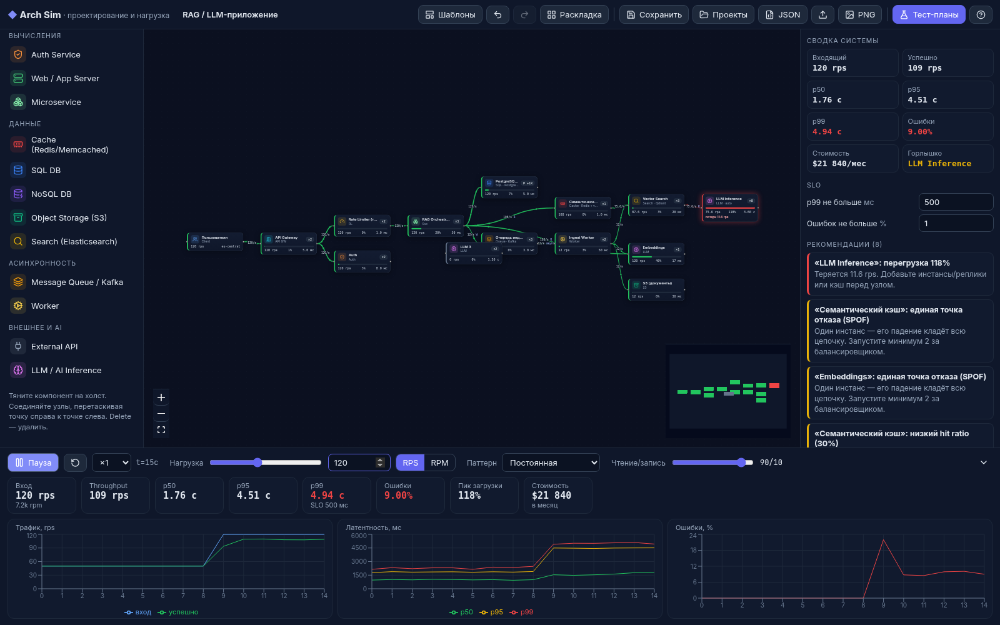

# Arch Sim — конструктор архитектуры и симулятор нагрузки

Интерактивный веб-инструмент для проектирования систем (system design): собираете архитектуру из компонентов на холсте, задаёте параметры серверов, подаёте нагрузку в RPS/RPM и смотрите, где система ломается. Есть тест-планы (load, stress, spike, soak, failover) с графиками, отчётом и рекомендациями.

**Онлайн:** https://javedius.github.io/arch-sim/



## Возможности

- **Холст (React Flow):** drag & drop компонентов, связи, мини-карта, зум, авто-раскладка (dagre), undo/redo (Ctrl+Z / Ctrl+Shift+Z), удаление (Delete), дублирование.
- **AI — отдельная группа в палитре:** LLM API (токены/с, TTFT, входные/выходные токены, $ за 1M токенов, TPM-лимит → 429), Self-hosted LLM на GPU (тип GPU с пресетами L4/A10G/A100/H100/H200, continuous batching, ток/с, реплики, $/час), Embedding service, Vector DB (QPS, recall, размер индекса, реплики), RAG Orchestrator, AI Agent (шагов на запрос — умножает все вызовы LLM и инструментов), MCP server, Semantic cache, Guardrails/Moderation. Латентность и стоимость AI-узлов считаются из токенов, в инспекторе — расчёт: время ответа, ёмкость, цена запроса, токенов в минуту.
- **Ещё 18 базовых компонентов:** Клиенты, DNS, CDN, Load Balancer (L4/L7; round-robin / least-conn / weighted), API Gateway, Rate Limiter, Auth, Web/App Server, Microservice, Cache (Redis/Memcached), SQL DB (primary + read-реплики, шардирование, failover), NoSQL, Message Queue/Kafka (партиции, lag), Worker, Object Storage (S3), Search (Elasticsearch), External API, LLM/AI Inference.
- **Параметры узла:** инстансы, CPU, RAM, макс. RPS на инстанс, латентность, доля ошибок, цена $/час и за 1000 запросов, регион, число AZ, autoscaling (макс. инстансов), hit ratio, реплики, шарды, лимит rate limiter и т.д. Смена CPU пропорционально меняет RPS и цену.
- **Связи:** `route` (распределить запрос в один из узлов — как балансировщик) или `call` (вызов зависимости на каждый запрос, можно 0.3 или ×5), фильтр чтение/запись, асинхронная доставка (очередь → воркер).
- **Нагрузка:** RPS ⇄ RPM, паттерны «постоянная», «рост», «всплеск ×5», «суточная волна», доля чтение/запись, скорость времени ×1…×30.
- **Живая симуляция:** точки бегут по рёбрам, толщина — объём трафика, цвет узлов: зелёный < 60% < жёлтый < 85% < красный; потери, lag очередей, p50/p95/p99, throughput, ошибки, стоимость в месяц, бутылочное горлышко.
- **Fault injection:** «Убить узел» в инспекторе. Упавший кэш обходится (cache-aside) — нагрузка уходит в БД.
- **Тест-планы:** Load, Stress (поиск точки отказа до ×4), Spike, Soak (4 часа), Failover узла, отказ AZ, падение кэша, падение primary БД. Проверка SLO, время восстановления, графики, рекомендации, отчёт в Markdown, прогон всего набора.
- **Шаблоны:** 3-tier, URL Shortener, Twitter-лента (fan-out on write), мессенджер, видеостриминг, RAG-ассистент, мультиагентная система с MCP-инструментами, AI-поддержка клиентов на сотни RPS (маршрутизация между маленькой GPU-моделью и большой LLM API).
- **AI-рекомендации:** семантический кэш, continuous batching, model routing (маленькая модель для простых запросов), TPM-лимиты и fallback-провайдер, сжатие контекста, лимит шагов агента, guardrails, recall и шардирование векторной БД.
- **Проекты:** автосохранение и список проектов в localStorage, экспорт/импорт JSON, экспорт PNG.

## Стоимость и цены (ноябрь 2026)

- **Нагрузка в поле «Нагрузка» — это пик.** Месячная стоимость считается по **среднему** трафику: профиль «Суточная волна» (ночью ~20% пика, средний ≈ 54%), «Рабочие часы B2B» (≈ 30%) или «Пик 24/7» (верхняя оценка). Токены и запросы — по среднему RPS; узлы с autoscaling — по числу инстансов, нужному для среднего трафика (не ниже минимума); остальные — по фиксированному числу инстансов. Внизу — пик/средний RPS, $/мес, $ за 1M запросов; справа — разбивка по узлам (инстансы vs токены).
- **LLM API по умолчанию — gpt-5-mini:** $0.25 / 1M входных, $2.00 / 1M выходных, кэшированный вход $0.025 (−90%). Параметры «Prompt cache hit» и «Скидка на кэш. вход». Для сравнения: gpt-5-nano $0.05/$0.40, gpt-4o-mini $0.15/$0.60, Gemini 2.5 Flash-Lite $0.10/$0.40 (кэш $0.01), Gemini 2.5 Flash $0.30/$2.50, gpt-5 $1.25/$10, gpt-5.4 $2.50/$15. Источники: [OpenAI pricing](https://developers.openai.com/api/docs/pricing), [Gemini API pricing](https://ai.google.dev/gemini-api/docs/pricing).
- **Эмбеддинги:** text-embedding-3-small $0.02 / 1M токенов (в шаблонах — self-hosted bge-m3 на дешёвом инстансе).
- **GPU (on-demand, $/час):** L4 $0.59, A10 $1.29, A100 80GB $1.79, H100 SXM $3.99 (PCIe $2.89), H200 $5.29 — [RunPod](https://www.runpod.io/pricing), Lambda. Для 70B-моделей реплика = 4 GPU.
- **Пропускная self-hosted:** Llama-3.1-8B на H100 в vLLM — ~158 ток/с на поток при batch 1, ~2 900 ток/с суммарно при 32, ~4 000 при 64 ([бенчмарк vLLM](https://runinfra.ai/engines/vllm)). Модель: `скорость потока = v₁ / (1 + 0.024·(batch−1))`.

## Модель симуляции

Каждый тик (1 с симуляции × скорость):

1. **Поток.** Граф обходится в топологическом порядке (циклы игнорируются с предупреждением). Клиенты генерируют чтения/записи. `route`-связи делят трафик по весу (LB: round-robin — поровну, least-conn — пропорционально ёмкости, упавшие бэкенды исключаются), `call`-связи получают трафик × число вызовов. CDN и кэш пропускают дальше только промахи.
2. **Очереди M/M/c.** Узел — пул из `c` инстансов с интенсивностью `μ = maxRps`. Вероятность ожидания — формула Эрланга C, среднее ожидание `C / (cμ − λ)`. При `λ > cμ` лишнее теряется (таймауты). У SQL — отдельные пулы для записи (primary × шарды) и чтения (реплики × шарды).
3. **Очередь сообщений.** Отвечает сразу; воркеры разбирают со скоростью `min(инстансы, партиции) × μ`, остаток копится в backlog → lag.
4. **Латентность.** p50/p95/p99 считаются методом Монте-Карло: ~1200 сэмплов запросов проходят по графу со случайной (логнормальной) латентностью обработки, ожиданием в очереди, ошибками, промахами кэша и межрегиональными задержками.
5. **Стоимость:** инстансы × $/час × 730 + запросы × цена за 1000.
6. **Токены (AI).** LLM API: `латентность = TTFT + out / ток·с⁻¹`, `цена = in·$in/1M + out·$out/1M`, `ёмкость = TPM / (in+out) / 60` (сверх — 429). GPU: скорость потока падает с batch (`v / (1 + 0.024·(b−1))`), `латентность = TTFT + prefill(in) + out / v`, `ёмкость реплики = batch / латентность`. Embeddings: `ёмкость = ток·с⁻¹ / in`. Vector DB: латентность растёт с recall и размером индекса. Агент: каждый шаг повторяет все call-вызовы.
7. **Autoscaling:** при загрузке > 70% +30% инстансов (не чаще раза в 10 с), при < 30% — уменьшение.

Модель учебная («на салфетке»): она хорошо показывает порядки величин, бутылочные горлышки и эффект кэшей/реплик/очередей, но не заменяет реальный нагрузочный тест.

## Запуск

```bash
npm install
npm run dev        # http://localhost:5173
npm test           # unit-тесты движка (vitest)
npm run build      # статическая сборка в dist/
npm run shot       # headless-проверка в Chrome (playwright) + скриншоты в /workspace
```

Бэкенд не нужен — это статический фронтенд, хостится где угодно (GitHub Pages, Netlify, S3, nginx). Для сборки под подпуть: `BASE_PATH=/arch-sim/ npm run build`.

## Стек

React 19 + TypeScript + Vite, @xyflow/react (React Flow), zustand, Recharts, dagre, html-to-image, lucide-react, vitest, playwright.

## Структура

```
src/sim/        движок: types, catalog (компоненты и параметры), engine (поток, M/M/c, Монте-Карло),
                scenarios (тест-планы, рекомендации, отчёт), templates, layout
src/components/ UI: холст, узлы, рёбра, палитра, инспектор, панель нагрузки, тест-планы
src/store.ts    состояние (zustand): граф, история undo/redo, симуляция, сохранение
```
